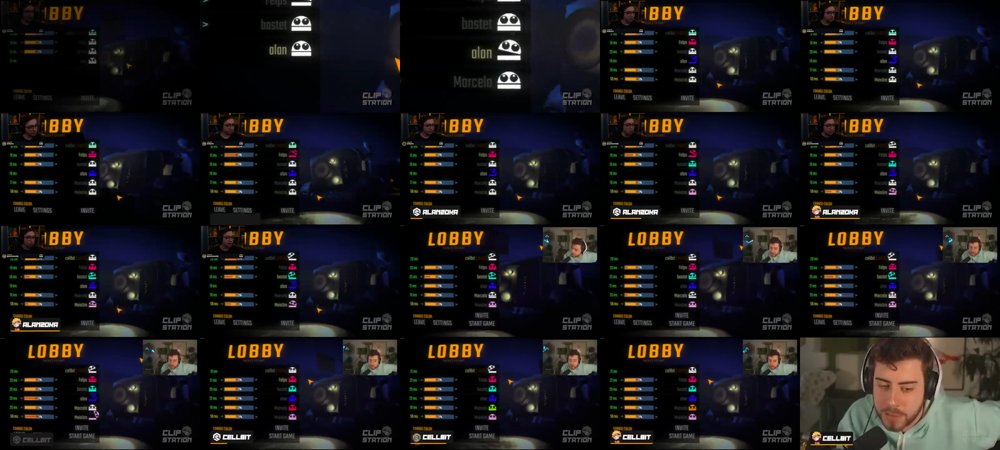
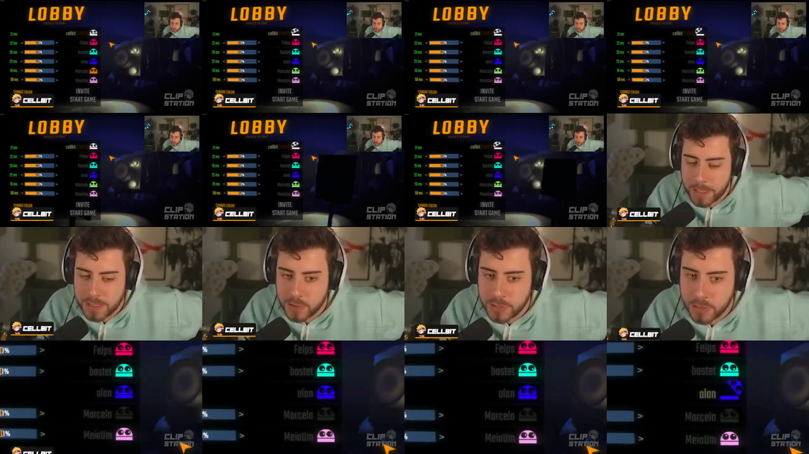
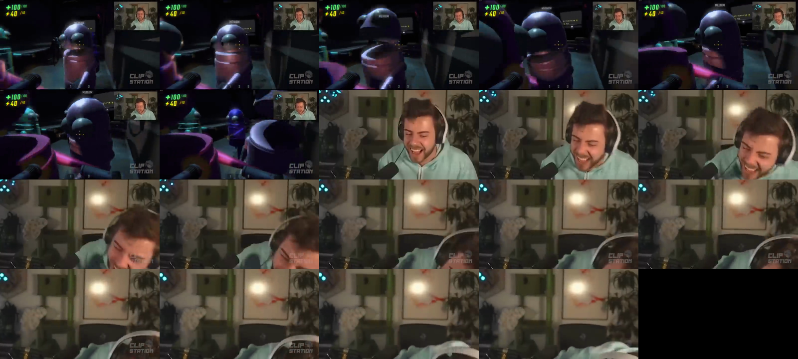
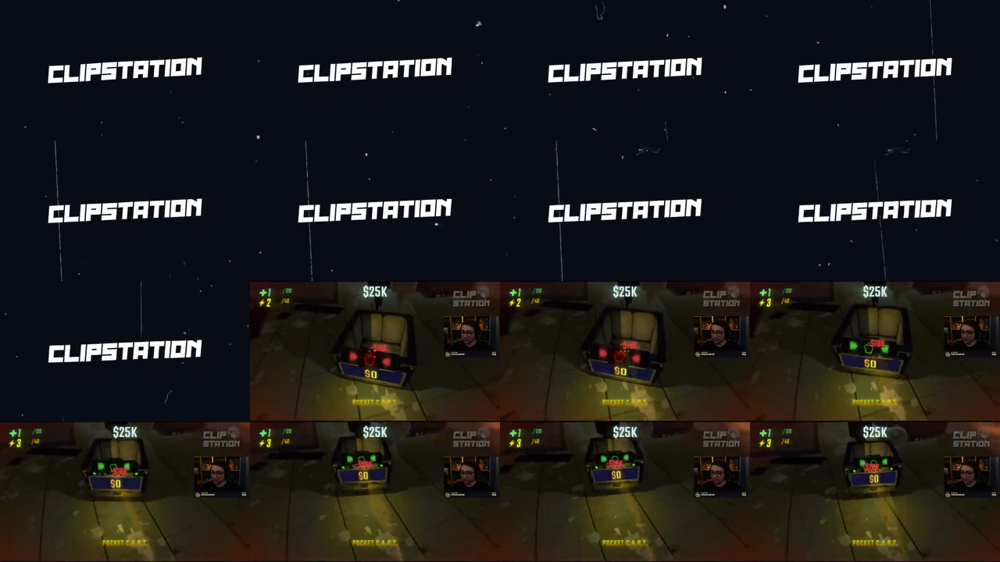
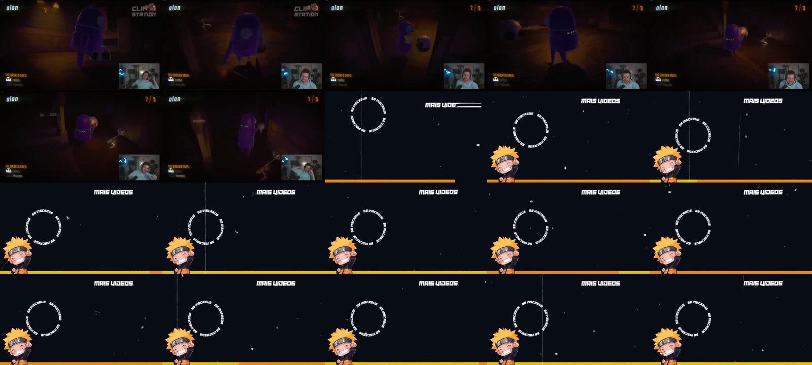

# Desmonte da edição — `exemplo.mp4`

**Formato:** compilação de clipes de lives ("CLIPSTATION") do jogo cooperativo R.E.P.O., alternando
o POV de vários streamers da mesma partida.

| Item | Valor |
|---|---|
| Duração | 14:20 (860,5 s) |
| Resolução / FPS | 640×360 (provavelmente reupload de um 1920×1080), 29,97 fps |
| Áudio | AAC estéreo 44,1 kHz, loudness integrado **−13,5 LUFS** (alto, padrão YouTube "gamer") |
| Cortes detectados | 93 (limiar de cena 0,25) → ver `cortes_detectados.txt` |
| Duração dos planos | mediana **2,6 s**, média 9,2 s (planos longos de gameplay + rajadas de cortes rápidos nos momentos de reação) |

---

## 1. Estrutura geral (macro)

```
[0:00–1:03.1]  COLD OPEN              → lobby com tag de nome de cada jogador + 1º momento engraçado
[1:03.1–1:08.2] VINHETA "CLIPSTATION" → 5,1 s, aparece UMA vez só (abre o vídeo de verdade)
[1:08.2–2:27.5] BLOCO 1
[2:27.5]        FLASH BRANCO (4 quadros)
[2:27.6–3:40.4] BLOCO 2
 ...            flashes em 2:27.5, 3:40.4, 4:47.8, 5:41.2, 6:53.4, 9:02.4, 10:22.1, 12:15.1
[12:15.3–14:06.6] ÚLTIMO BLOCO
[14:06.6–14:20.5] TELA FINAL "MAIS VÍDEOS / SE INSCREVA" (13,9 s)
```

Cada **bloco** ≈ 1 nível/rodada do jogo (60–130 s). Dentro do bloco, a montagem pula entre
os POVs dos streamers para contar a mesma situação de ângulos diferentes.

Os pontos em que o detector achou **3 cortes no mesmo quadro** são as transições entre blocos.
Medindo a luminância quadro a quadro, elas são um **estrobo branco de 4 quadros**
(Y ≈ 226 → 174 → 226 → 190), não a vinheta.



---

## 2. Elementos que se repetem (o "kit" da edição)

### 2.1 Layout base do clipe
- Gameplay em **tela cheia** (o recorte da live, com a webcam que o streamer já tinha no overlay
  dele — por isso a cam muda de lugar/tamanho de streamer para streamer).
- HUD do jogo mantido (vida/energia no canto sup. esquerdo, dinheiro no sup. direito).
- Nada de borda ou fundo desfocado — é 16:9 puro.

### 2.2 Marca d'água
- Logo **"CLIP STATION"** (texto branco com contorno/sombra, ~50% de opacidade) **fixo no canto
  superior direito** durante o vídeo todo (em clipes cujo HUD ocupa esse canto, ela sobrepõe o HUD).
- Tamanho ≈ 8–9% da largura do quadro, margem ≈ 2%.

### 2.3 Tag de nome do streamer (lower third)
- Aparece **no começo de cada streamer novo** (muito visível no lobby: ALANZOKA, CELLBIT…).
- Canto **inferior esquerdo**: avatar redondo (personagem anime) + nome em fonte bold
  itálica branca caixa-alta, numa pílula preta.
- Animação: **pop/scale-in** rápido (~5 frames), fica 2–4 s, some.
- Quando o vídeo dá zoom na cam, a tag continua lá (está por cima de tudo).



### 2.4 Zoom na webcam (o recurso mais usado)
- Nos momentos de reação (grito, risada, susto) o editor **corta seco** do gameplay para a
  **webcam em tela cheia** (crop da cam do próprio streamer escalado até 640×360).
- Duração: 1–4 s, depois corta de volta pro gameplay.
- Muitas vezes com **zoom-in contínuo/shake** (escala aumentando 100%→130%) e, quando o streamer
  sai do quadro, segue mostrando o quarto vazio = piada visual.
- Imagem fica bem pixelada (upscale de cam pequena) — faz parte do estilo, não é problema.



### 2.5 Vinheta (uma vez) e flashes (entre blocos)
**Vinheta, 1:03.1–1:08.2 (5,1 s):**
- 1 quadro preto → fundo azul-marinho escuro (`#0b1220`) com **poeira e riscos verticais de "filme velho"**.
- Texto **"CLIPSTATION"** branco, fonte display bold/itálica, subindo para a direita (~6°),
  **entra deslizando da direita em ~0,7 s, com rastros de velocidade** (3 linhas paralelas), e depois fica parado.
- Sai com o mesmo flash branco das transições.

**Flash entre blocos:** 4 quadros (~0,13 s) de estrobo branco/cinza, com corte seco para o próximo bloco.



### 2.6 Outro / tela final (≈13 s)
- Mesmo fundo do stinger (azul-marinho + partículas).
- Texto "MAIS VÍDEOS" no canto superior direito entrando com wipe de barras.
- Círculo de texto girando **"SE INSCREVA • SE INSCREVA"** (área do botão de inscrição do YouTube).
- Mascote no canto inferior esquerdo (na recriação foi trocado por um robô original, criado do zero).
- **Barra de progresso laranja/amarela** no rodapé enchendo da esquerda para direita (contador do end screen).
- Espaço vazio à direita = onde entram os cards de "vídeo sugerido" do YouTube.



### 2.7 Telas de nível
- Cards do próprio jogo ("LEVEL 3 – HEADMAN MANOR", "GAME OVER – DISPOSAL ARENA") são mantidos como
  **divisores narrativos naturais** — não precisam ser criados.

---

## 3. Ritmo / lógica de montagem
1. **Setup** (gameplay normal, plano longo 10–40 s) → contexto da situação.
2. **Escalada**: cortes de 2–3 s alternando POVs de streamers diferentes.
3. **Clímax**: susto/morte → corte para **webcam em tela cheia** (1–4 s).
4. **Respiro**: volta para gameplay ou pula para o próximo momento.
5. A cada nível/rodada → **flash branco** de 4 quadros (a vinheta CLIPSTATION aparece só uma vez, após o cold open).

Áudio: sempre o áudio original da live (voz + jogo), sem trilha de fundo perceptível; volume
puxado para ~−14 LUFS.

---

## 4. Como replicar (receita)

Ferramenta pronta: [`scripts/montar_clipstation.sh`](../scripts/montar_clipstation.sh) (ffmpeg).
Passo a passo manual (Premiere/CapCut/DaVinci) ou via script:

| # | Passo | Parâmetros |
|---|---|---|
| 1 | Projeto 1920×1080, 30 fps | |
| 2 | Importar VODs/clipes de cada streamer, marcar os momentos | |
| 3 | Montar cold open (lobby + tags de nome) ~20 s | |
| 4 | Por rodada: setup → POVs alternados → zoom na cam | cortes secos |
| 5 | Zoom na cam: crop da região da webcam, escala até tela cheia, keyframe 100%→120% | 1–4 s |
| 6 | Tag de nome no início de cada streamer novo | inf. esq., 3 s, pop-in |
| 7 | Vinheta CLIPSTATION após o cold open; flash branco entre rodadas | 5,1 s / 4 quadros |
| 8 | Marca d'água fixa sup. dir. | 50% opacidade |
| 9 | Tela final 13–20 s | |
| 10 | Normalizar áudio | `loudnorm=I=-14:TP=-1` |

### Dados de entrada do script
O script lê um arquivo de roteiro (`roteiro.txt`) com uma linha por segmento:

```
# tipo   | arquivo      | inicio | fim   | extra
clip     | cellbit.mp4  | 00:10  | 00:35 | nome=CELLBIT
cam      | cellbit.mp4  | 00:35  | 00:38 | crop=480:270:1440:0
stinger  |              |        |       | dur=5.1
clip     | alan.mp4     | 01:02  | 01:20 | nome=ALANZOKA
flash    |              |        |       |
outro    |              |        |       |
```

---

## 5. Recriação

`roteiro_recriacao.txt` remonta o vídeo inteiro usando o próprio `exemplo.mp4` como fonte (não há VODs
brutos). Os trechos de conteúdo foram mantidos e a vinheta, os 8 flashes e a tela final foram
**regerados** por `scripts/grafismos.py`. Como a marca d'água já vem gravada no conteúdo, a recriação roda sem
aplicar outra:

```bash
MARCA="" W=1280 H=720 scripts/montar_clipstation.sh analise/roteiro_recriacao.txt recriacao.mp4
```
